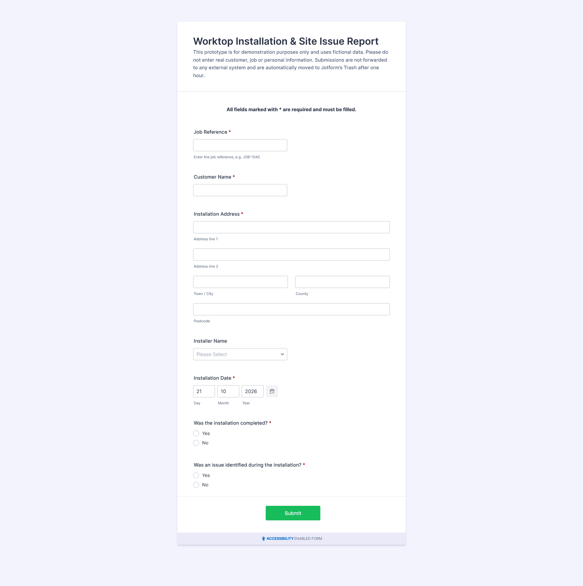
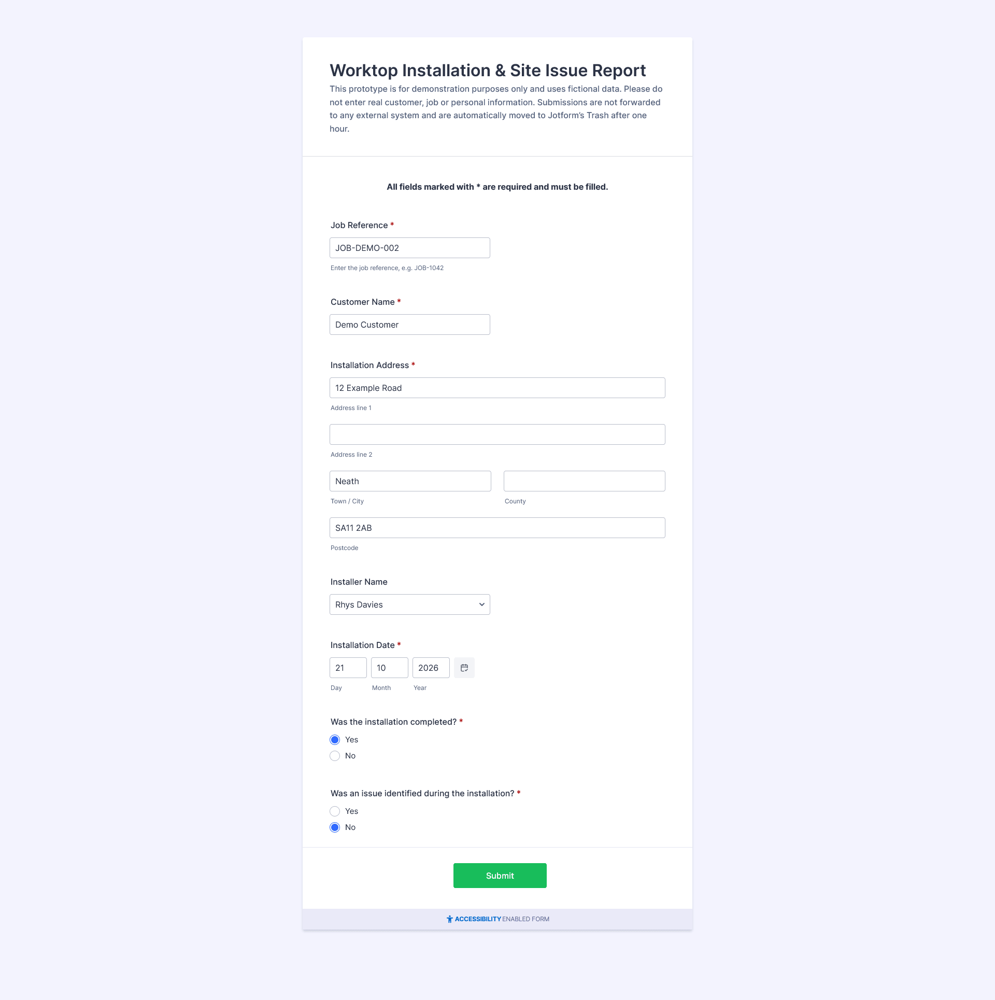
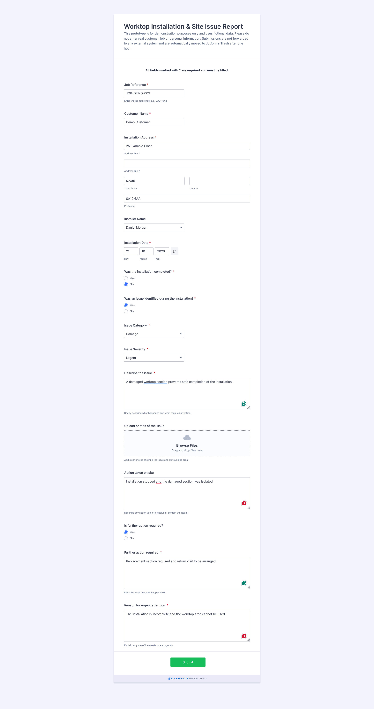
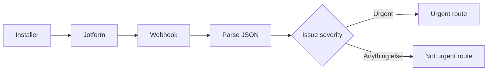
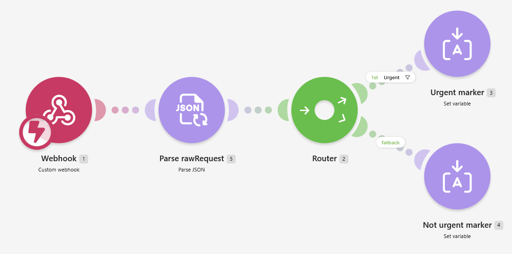
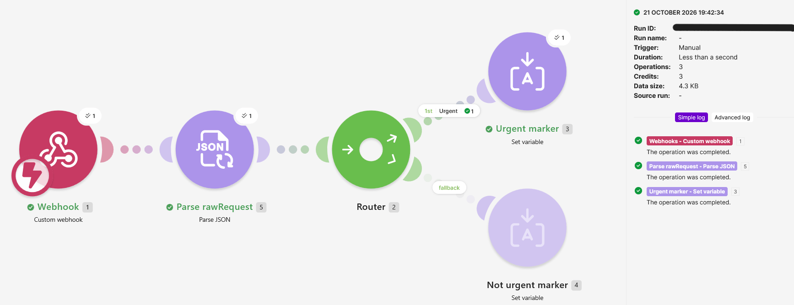

# Field-Service Workflow Prototype

> **A paper-style site issue report, rebuilt as a structured digital workflow.**

This is a self-directed, AI-assisted practice project created in response to a recent job application process where **Jotform, webhooks and Make** were relevant technologies.

The prototype models a simple worktop-installation workflow: an installer records the outcome of a visit, the form adapts when a problem is reported, and the submitted data can be routed automatically according to issue severity.

## Choose your view

- **I just want to see what it does:** stay on this page.
- **Show me the plumbing:** read the [technical walkthrough](TECHNICAL.md).

## Try the live form

**Live demo:** https://form.jotform.com/262934757080060

The public form is a demonstration only. Please use fictional data.

The live demo is **not connected to the Make automation** used during development and testing. That integration was disconnected after the routing tests were completed.

## The problem being modelled

A field installer needs a quick way to record whether an installation was completed and whether anything needs follow-up.

A static form can collect that information, but it can also create unnecessary work. Someone reporting a clean installation should not have to work through issue fields that do not apply to them. Someone reporting an urgent problem should be prompted for the extra information the office needs.

The prototype therefore focuses on three things:

1. **Keep the clean path short.**
2. **Collect extra detail only when it is relevant.**
3. **Turn the submission into structured data that can support downstream automation.**

## What the form does

The form captures basic job and installer information, then changes according to the answers given.

- If **no issue** is reported, the installer sees a short path to submission.
- If an **issue** is reported, category, severity and description fields appear.
- If **further action** is needed, an additional follow-up field appears.
- If the issue is **Urgent**, the installer must explain why urgent attention is required.

### Clean installation path

### Urgent issue path

## From form to workflow

During development, the form was connected to a Make webhook so I could inspect the submission structure and build a simple routing workflow.

The Make prototype did not send emails, update a CRM or write to a production database. Each branch simply set an internal variable so the routing behaviour could be tested safely.

## What was tested

The form itself was tested through clean-installation, non-urgent issue and urgent-issue scenarios. The webhook payload was then inspected and the Make routing logic was tested separately.

The final routing tests confirmed:

| Test | Expected result | Result |
|---|---|---|
| Blank severity / no issue | `not_urgent` | Passed |
| Severity = `Urgent` | `urgent` | Passed |

### Make scenario

### Successful urgent-route test

## Data and privacy

This project uses **fictional test data only**.

For the public demo:

- the Make webhook has been removed;
- no other external integrations are connected;
- visitors are asked not to enter real customer, job or personal information;
- submissions are configured to move to Jotform's Trash after **one hour**;
- Jotform then applies its normal Trash retention process before permanent deletion.

No webhook URLs, API keys, tokens, credentials, IP addresses, account identifiers or private submission metadata are included in this repository.

A [sanitised example payload](samples/sanitised-payload.json) is included to show the data shape without exposing development metadata.

## How AI was used

This was an **AI-assisted project**, not an exercise in pretending the assistance was not there.

I configured the Jotform fields, conditional behaviour and form settings, ran the test submissions, connected and tested the webhooks, inspected the results, made the workflow decisions and verified the final routing behaviour.

AI tools acted mainly as a **support/teaching layer**: helping me reason through configuration choices, test cases, payload structure and documentation.

For the Make stage, **Make's Maia assistant was used to generate/configure parts of the scenario**, including the JSON parsing and route setup. I reviewed the generated configuration and tested both branches against live Jotform submissions before accepting the result.

More detail is in [How the workflow works](TECHNICAL.md#ai-assistance-and-ownership).

## What I learned

The useful part of this exercise was not simply learning where buttons are in Jotform or Make. It was working through the full chain:

**operational requirement → form design → validation → conditional logic → webhook payload → parsing → routing → testing**.

It also reinforced a point that matters in operational technology work: the interface used by the person on site and the structured data needed downstream should be designed together.

## Current status

This is a **prototype / portfolio demonstration**, not a production system.

The public Jotform remains available so the conditional behaviour can be explored, but the downstream Make webhook has been deliberately disconnected after testing.

For implementation details, field mappings, routing logic, testing notes, limitations and possible production improvements, continue to the **[technical walkthrough](TECHNICAL.md)**.
