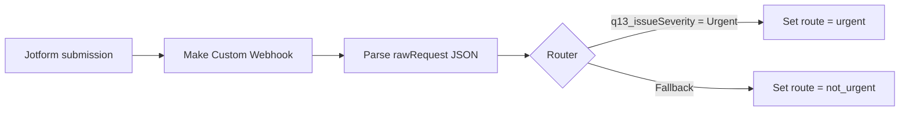

# Technical walkthrough

This document is the deeper technical view of the [Field-Service Workflow Prototype](README.md).

## Architecture

The tested development flow was:



The public Jotform is no longer connected to the webhook. The Make scenario was used only for development and testing.

## Jotform design

The form was built from scratch as a one-page Classic Form rather than generated from a form-building AI prompt. The goal was to understand the field model, conditions and settings directly.

### Core fields

| Field | Type | Purpose |
|---|---|---|
| Job Reference | Short Text | Controlled job identifier entered by the installer |
| Customer Name | Short Text | Fictional customer name in the demo |
| Installation Address | Address | Structured site location |
| Installer Name | Dropdown | Controlled installer value for cleaner downstream data |
| Installation Date | Date Picker | Date-only installation record |
| Was the installation completed? | Single Choice | Yes / No |
| Was an issue identified? | Single Choice | Controls issue-related fields |
| Issue Category | Dropdown | Categorises the problem |
| Issue Severity | Single Choice | Low / Medium / Urgent |
| Describe the issue | Long Text | Required issue description when an issue is reported |
| Upload photos of the issue | File Upload | Optional supporting evidence, max 3 image files |
| Action taken on site | Long Text | Optional containment/resolution note |
| Is further action required? | Single Choice | Controls follow-up detail |
| Further action required | Long Text | Follow-up requirement when applicable |
| Reason for urgent attention | Long Text | Additional context for urgent reports |

### Conditional visibility

The form uses progressive disclosure so irrelevant fields stay hidden.

- `Issue identified = Yes` shows issue category, severity, description, photo upload, action taken and further-action question.
- `Further action required = Yes` shows the follow-up detail field.
- `Issue Severity = Urgent` shows the urgent-attention explanation.

### Conditional requirements

The tested configuration requires:

- Issue Category when an issue is reported.
- Issue Severity when an issue is reported.
- Issue Description when an issue is reported.
- Further Action detail when further action is marked Yes.
- Reason for Urgent Attention when severity is Urgent.

### Form settings and design decisions

Selected settings included:

- **Clear hidden field values:** clear when hidden, to avoid stale conditional data being submitted after a user changes an answer.
- **Form language:** English (UK).
- **Accessibility:** enabled.
- **Lite Mode:** off, following the accessibility warning shown during configuration.
- **Error navigation:** enabled.
- **Save and continue later:** off.
- **Browser autocomplete:** off, to reduce the chance of stale customer/job data being inserted automatically.
- **Prevent cloning:** enabled.
- **Layout:** one page.
- **Form-data encryption:** off for this fictional prototype, avoiding unnecessary integration complexity during testing.

A UK-specific postcode pattern was identified as a possible enhancement rather than added to the prototype.

## Webhook inspection

Before Make was configured, **Webhook.site** was used temporarily as a free development endpoint to inspect what Jotform sent.

Only fictional data was submitted. The temporary endpoint was never intended to be part of a production architecture and its URL is deliberately not included here.

The inspection showed that Jotform sent a `multipart/form-data` request containing a `rawRequest` value. `rawRequest` contained the form submission as a JSON string.

Useful fields observed included:

```text
q3_jobReference
q4_customerName
q5_installationAddress
q7_installerName
q8_installationDate
q9_wasThe
q10_wasAn
q11_issueCategory
q13_issueSeverity
q14_describeThe
q17_actionTaken
q18_isFurther
q19_furtherAction
q20_reasonFor
```

The [sanitised payload](samples/sanitised-payload.json) contains representative fictional values only. Webhook URLs, IP addresses, usernames, submission identifiers, form identifiers and other request metadata have been removed.

## Make scenario

### 1. Custom Webhook

A Make **Custom Webhook** received each Jotform submission during testing.

No API-key authentication was added to the prototype webhook. The endpoint was temporary and used only with fictional test data. The webhook URL is not published in this repository.

### 2. Parse `rawRequest`

Because the useful form values arrived inside `rawRequest` as a JSON string, a **JSON > Parse JSON** module exposed them as fields Make could reference.

The route decision uses:

```text
q13_issueSeverity
```

### 3. Router

The router contains two paths.

#### Urgent

Condition:

```text
q13_issueSeverity = Urgent
```

The branch uses a Make **Set variable** module to set:

```text
route = urgent
```

#### Not urgent

The second route is the fallback/catch-all. It handles every other value, including Low, Medium, blank or missing severity.

It sets:

```text
route = not_urgent
```

The variables are markers only. No external service is called and the branch does not email, store or forward the submission.

> **Screenshot placeholder:** Full Make scenario.
>
> **Screenshot placeholder:** Urgent route filter showing the exact comparison.

## Testing

### Form behaviour

Three main form scenarios were tested:

| Scenario | Key input | Expected behaviour | Result |
|---|---|---|---|
| Clean installation | Issue = No | Issue fields remain hidden; form submits | Passed |
| Non-urgent issue | Issue = Yes, Severity = Medium | Relevant issue fields appear and required fields are enforced | Passed |
| Urgent issue | Issue = Yes, Severity = Urgent, Further action = Yes | Urgent and follow-up fields appear and are required | Passed |

Testing also led to a usability change: **County was changed from required to optional** after it created unnecessary friction in a test submission.

### Webhook payload

A clean submission confirmed that the webhook received structured job, address, installer and completion values while conditional issue fields were blank.

An issue submission confirmed that category, severity, description, action and follow-up fields populated correctly when those branches were used.

### Routing

The final Make routing tests were:

| Input | Expected route | Observed route |
|---|---|---|
| Blank `q13_issueSeverity` | `not_urgent` | `not_urgent` |
| `q13_issueSeverity = Urgent` | `urgent` | `urgent` |

Both tests passed and the scenario validated without errors.

## Public demo and data handling

The public form is available at:

https://form.jotform.com/262934757080060

After development testing:

- the Make webhook was removed from the form;
- there were no other external integrations attached;
- the form was retained as an interactive demonstration of the conditional behaviour;
- visitors are instructed to use fictional data only;
- submissions are configured to move to Jotform's Trash after one hour, after which Jotform applies its normal Trash-retention process.

The optional image-upload field remains part of the public demo because image evidence is a realistic part of the modelled field-service workflow. Visitors are explicitly told not to upload real customer or personal information.

## AI assistance and ownership

The project intentionally documents where AI assistance was used.

### Work I carried out directly

I:

- defined the prototype use case;
- built and configured the Jotform fields;
- selected the controlled dropdown values and field requirements;
- configured and reviewed the conditional behaviour;
- made form-setting and usability decisions;
- entered and submitted the fictional test cases;
- connected Jotform first to the inspection webhook and then to Make;
- inspected the resulting payloads;
- decided the required routing behaviour;
- ran the live branch tests;
- checked the resulting route behaviour and accepted the implementation only after both branches passed.

### AI used as support / teacher

AI assistance was used to:

- explain unfamiliar Jotform and Make options;
- discuss form and workflow design choices;
- propose structured test cases;
- help interpret the webhook payload;
- identify useful documentation points;
- assist with writing this portfolio documentation.

### Work delegated to Make Maia

Make's **Maia** assistant was used to generate/configure parts of the Make scenario after the webhook capture was working. This included the JSON parsing and routing/marker configuration.

That generated configuration was then reviewed and tested with live Jotform submissions. Both the fallback route and the Urgent route were verified before the workflow was treated as complete.

This distinction matters: this repository does not present AI-generated configuration as independently hand-authored implementation.

## Limitations and production improvements

This project stops deliberately at a safe prototype. A production implementation would need additional requirements and controls, potentially including:

- authenticated/secured webhook handling;
- formal access controls and data-retention policy;
- a production destination such as a service-management platform, CRM, ERP or database;
- notifications/escalation for urgent issues;
- idempotency and duplicate-submission handling;
- retry/error handling and operational monitoring;
- stronger validation where business rules require it;
- defined handling and storage rules for uploaded images;
- audit requirements and user/account management;
- stakeholder testing with real production/warehouse/office workflows before rollout.

These are deliberately described as **future production considerations**, not features implemented in this prototype.

## Screenshot plan

The repository will use screenshots to make both reading paths easier to follow. See [docs/images/README.md](docs/images/README.md) for the capture and redaction checklist.
